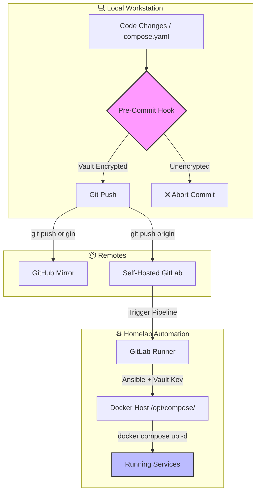

# Homelab

My homelab repository for learning and practicing modern DevOps practices, Infrastructure as Code (IaC), Configuration Management, and GitOps workflows. It is actively evolving since it doubles as a testing ground for self-hosted services upstream of my production environment.

## Technologies

* **Infrastructure Provisioning:** Terraform (Proxmox provider)
* **Configuration & Orchestration:** Ansible
* **Container Runtime:** Docker & Docker Compose
* **Ingress & Routing:** Traefik
* **CI/CD & Version Control:** GitLab CI/CD (mirrored to GitHub)
* **Secrets Management:** Ansible Vault

---

## Deployment Workflow



---

## Security

Secrets in `group_vars/all/vault.yaml` are encrypted at rest using Ansible Vault. There's also a git pre-commit hook that blocks commits if `vault.yaml` is unencrypted.

### Commonly Used Commands

```bash
# Edit vault file
ansible-vault edit group_vars/all/vault.yaml

# Run playbook manually
ansible-playbook -i inventory/hosts.yaml site.yml --ask-vault-pass

```
